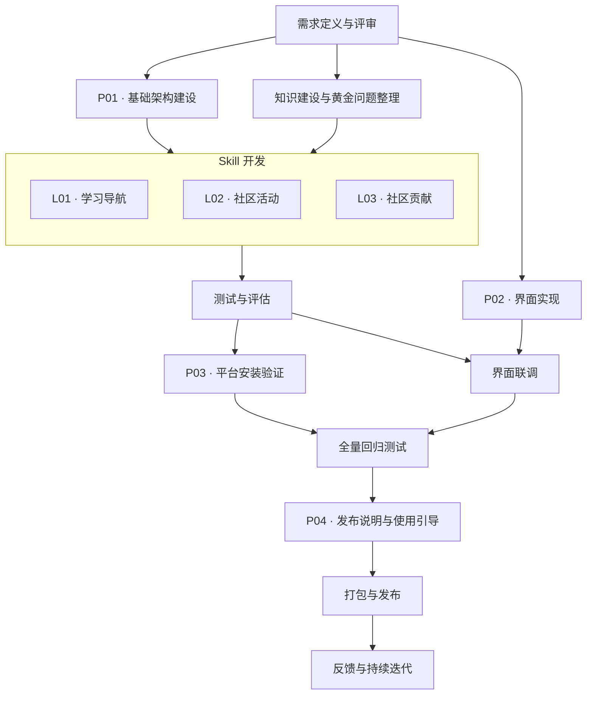

# Datawhale 鲸宝 · Whale Baby

Agent Skills for AI learning and community engagement.

## 项目介绍

鲸宝是 Datawhale 的第一组 Skills，旨在将开源学习资源、社区活动与贡献机会封装为 AI 客户端可直接调用的能力，围绕「学什么、怎么参与」提供有出处、有下一步的学习与社区参与指引。

第一期面向 AI 学习者与社区贡献者，采用标准 [Agent Skills](https://agentskills.io/) 格式，以 DSH 和 WorkBuddy 为目标平台，推进核心 Skill 开发、界面实现与联调、安装验证及发布。

## 核心能力

| 编号 | Skill    | 核心能力                               |
| :--- | :------- | :------------------------------------- |
| L01  | 学习导航 | 学习方向、课程推荐、学习路线与行动建议 |
| L02  | 社区活动 | 社区介绍、活动推荐与参与指引           |
| L03  | 社区贡献 | 贡献机会、能力匹配与贡献指引           |

## 开发路线图

**当前阶段：第一期开发**

状态说明：☐ 待确认 · ◐ 进行中 · ☑ 已完成

| 编号   | 开发任务                                       |   状态   |
| :----- | :--------------------------------------------- | :------: |
| P01    | SKILL.md 模板、目录结构与仓库脚手架            | ◐ 进行中 |
| L01-01 | 收集课程清单、路线与常见顾虑，转成知识卡       | ☐ 待确认 |
| L01-02 | 编写学习导航 SKILL.md，对照问题集自测          | ☐ 待确认 |
| L01-03 | 整理学习线黄金问题 8 条                        | ☐ 待确认 |
| L02-01 | 收集社区介绍、活动日历与参与方式               | ☐ 待确认 |
| L02-02 | 编写社区活动 SKILL.md，对照问题集自测          | ☐ 待确认 |
| L02-03 | 整理活动线黄金问题 6 条                        | ☐ 待确认 |
| L03-01 | 收集当前贡献机会、门槛与流程                   | ☐ 待确认 |
| L03-02 | 编写社区贡献 SKILL.md，对照问题集自测          | ☐ 待确认 |
| L03-03 | 整理贡献线黄金问题 6 条                        | ☐ 待确认 |
| P02    | 三个界面的实现与联调（首页 / 对话 / Skill 库） | ☐ 待确认 |
| P03    | DSH 与 WorkBuddy 安装验证                      | ☐ 待确认 |
| P04    | 发布说明与使用引导                             | ☐ 待确认 |

### 开发流程

优先跑通 L01，随后推进 L02、L03。界面开发根据实际开发条件单独排期，与 Skill 开发并行。

第一期交付目标：成功上架、能装、能用、口径明确。

## 开发规范

### Skill 定义

每个 Skill 采用独立目录组织，以 `SKILL.md` 定义能力，以 `references/` 管理知识。

| 要素 | 内容                         |
| :--- | :--------------------------- |
| 触发 | 使用条件、适用场景与意图识别 |
| 流程 | 判断步骤、分支逻辑与处理方式 |
| 知识 | 知识卡、信息来源与引用路径   |
| 输出 | 回答结构与 Markdown 呈现格式 |
| 边界 | 能力范围与兜底规则           |

### 知识组织

知识按照稳定知识、动态知识与经验建议分类管理。

| 类型     | 典型内容                     | 维护方式                                 |
| :------- | :--------------------------- | :--------------------------------------- |
| 稳定知识 | 课程定位、角色定义           | 随内容改版更新                           |
| 动态知识 | 活动时间、报名入口、贡献机会 | 标注核对时间与有效期，到期后标记为待确认 |
| 经验建议 | 学习经验、实践建议           | 标注来源与适用条件，明确区别于官方规则   |

知识卡包含以下字段：

| 字段              | 说明                           |
| :---------------- | :----------------------------- |
| ID                | 知识的唯一标识                 |
| 标题              | 知识内容的简要描述             |
| 类型              | 稳定、动态或经验               |
| 内容              | 核心结论与适用条件，200 字以内 |
| 出处              | 官方链接或文档位置             |
| 提供者 / 确认人   | 知识提供与确认信息             |
| 核对时间 / 有效期 | 动态知识必填                   |
| 公开范围          | 可公开、处理后公开或仅内部     |

### 输出规范

采用 Markdown 组织回答，保持跨客户端的核心输出一致。

| 段落        | 内容               | 规格                 |
| :---------- | :----------------- | :------------------- |
| 结论        | 明确方向           | 一句话               |
| 路线 / 清单 | 路径与步骤         | 3–5 步，每步一个动作 |
| 对比 / 机会 | 对象与机会比较     | 表格不超过 5 列      |
| 推荐 / 匹配 | 推荐结果与适用条件 | 1–2 个对象           |
| 下一步      | 可执行行动         | 不超过 4 项          |
| 出处        | 信息来源与核对时间 | 不超过 3 条          |

结论、下一步与出处为必选项，其余根据实际问题组织。

### 能力范围

第一期聚焦学习导航、社区活动与社区贡献，提供信息判断与行动指引。

代报名、审批、作业批改、积分与金币管理、任务领取与提交、平台 API 对接及课程内容讲解不在第一期开发范围内。

## 测试与验收

### 黄金问题集

基于真实用户提问建立黄金问题集，覆盖核心场景、意图识别、知识准确性与能力边界。

| Skill    |  数量  | 测试重点                                     |
| :------- | :----: | :------------------------------------------- |
| L01      |   8    | 目标不清、基础不足、课程细节、超范围、承诺类 |
| L02      |   6    | 社区认知、活动时效、参与方式、名额与报名     |
| L03      |   6    | 贡献机会、参与门槛、首次贡献、代报名、内推   |
| **合计** | **20** |                                              |

### 验收指标

| 指标              | 目标  |
| :---------------- | :---: |
| 触发准确率        | ≥ 90% |
| 关键事实正确率    | 100%  |
| 下一步可执行率    | 100%  |
| 拒答准确率        | 100%  |
| 跨 Skill 误触发率 | ≤ 5%  |
| 平均追问轮数      |  ≤ 2  |

### 评测流程

1. 在 DSH 与 WorkBuddy 中分别运行黄金问题集。
2. 记录实际回答与判定结果（通过 / 部分 / 失败）。
3. 核对关键事实、业务规则、触发条件与输出完整性。
4. 按知识缺失、写法问题、触发问题进行归因。
5. 修复并重测失败项。
6. 发布前完成全量回归测试。

## 关于 Datawhale

    
    
扫描二维码关注 Datawhale 公众号，获取更多优质开源内容

